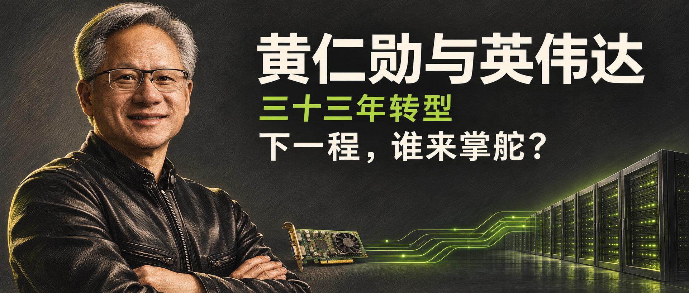
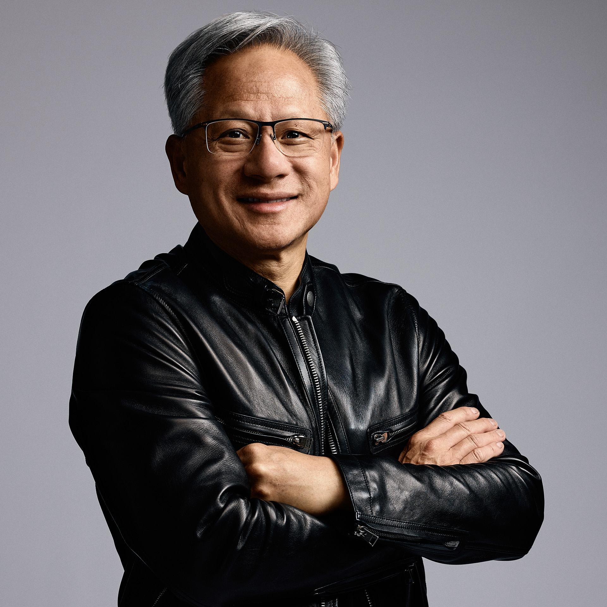
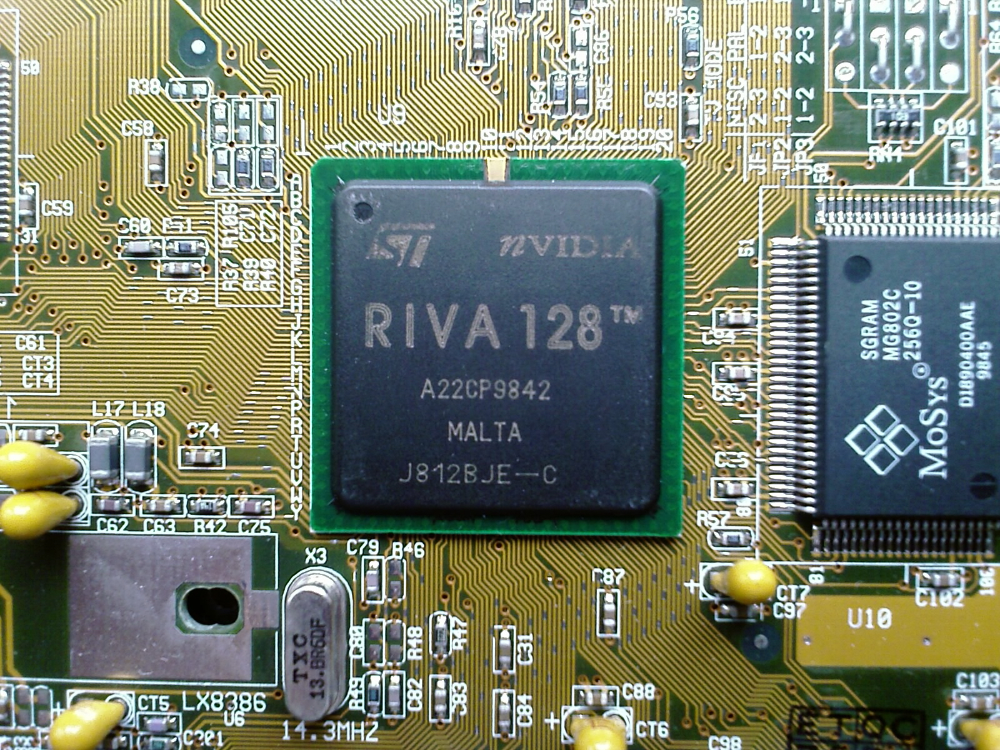
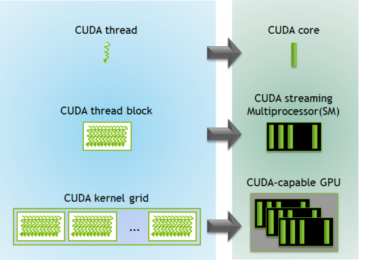
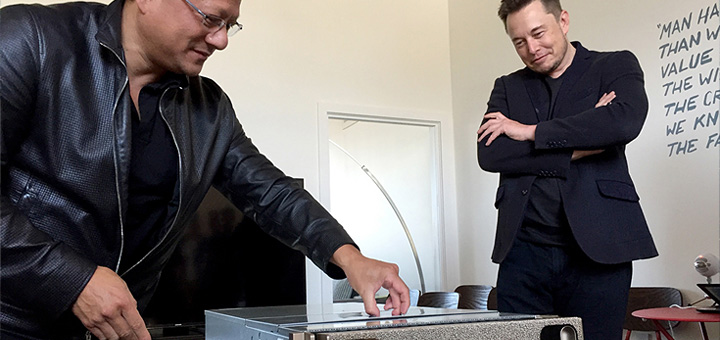
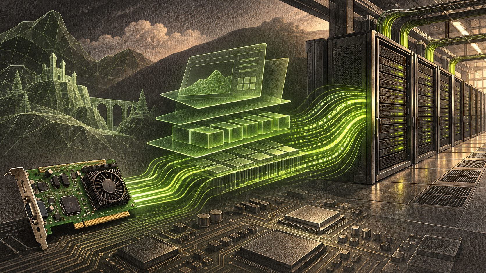
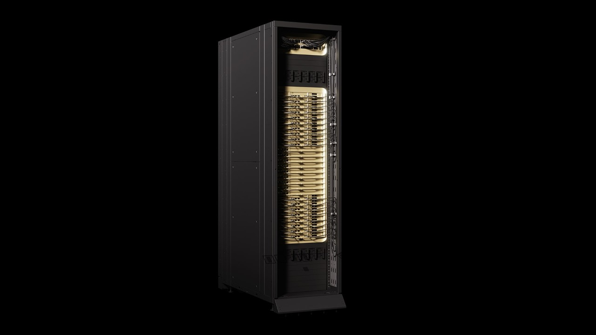

# 黄仁勋与英伟达：三十三年转型，下一程谁来掌舵

*封面｜AI生成概念插画，以黄仁勋官方人物照为形象参考，结合显卡、计算光路与服务器机柜表现转型主题，非新闻现场照片。*

**从图形芯片到加速计算平台，再到AI基础设施，英伟达的三十三年，是一连串重新选择方向、配置资源并承担失败风险的过程。随着黄仁勋离任，这家公司需要回答一个新的问题：由创始人推动的转型能力，能否成为组织自身的能力？**

*商业人物特稿｜人物·技术·产业*

*2026年11月14日*

*图1｜黄仁勋官方资料照。本文关注的是他推动的转型能力如何延续到组织之中。图片：[NVIDIA人物资料页](https://www.nvidia.com/en-eu/about-nvidia/governance/management-team/jensen-huang/)，非离任事件现场。*

---

## 序章｜创始人离任之后

2026年11月12日，美国加利福尼亚州圣克拉拉。

英伟达宣布，创始人黄仁勋辞去总裁、首席执行官及董事职务。首席财务官科莱特·克雷斯出任临时CEO，资深董事哈维·琼斯成为公司首位董事会主席，董事会将从内部和外部寻找正式继任者。根据公司提交的8-K文件，董事会于11月11日接受辞职并即时生效，次日对外公布。[^1]

63岁的黄仁勋结束了长达三十三年的掌舵生涯。就在此前，围绕其私人关系的媒体报道，以及可能涉及外国情报活动的指控，已引发董事会独立调查。调查的启动不等于指控成立，也不能据此认定发生了泄密。[^2]

英伟达已成为全球AI基础设施的重要供应商。它的技术路线、交付能力和销售范围，同时牵动客户投资、供应链与出口政策。创始人离任，因而带来了超出一般管理层更替的疑问。

**英伟达能否在失去核心决策者之后，继续识别下一轮计算需求，并承担提前投入的风险？**

要回答这个问题，需要回到它几次改变自身定位的时刻。黄仁勋的判断至关重要，但这些判断能够转化为产品，也依靠工程团队、开发者、制造伙伴，以及逐步成熟的市场需求。

## 第一章｜1963—1984：从台湾到美国

1963年2月17日，黄仁勋出生于台湾，童年曾随家人在泰国生活。约九岁时，他与哥哥被送往美国，后来进入肯塔基州的奥奈达浸礼会学校（Oneida Baptist Institute）。

他多年后回忆，母亲虽然不熟悉英语，仍借助词典教两个孩子学习英文。寄宿生活则要求他尽快适应语言、文化和人际关系的变化。

学校安排学生承担日常劳动，黄仁勋负责清洁卫生间。他也曾因亚裔身份受到欺负。成年后谈起这段经历时，他常强调困难、责任与适应能力。这些回忆可以帮助理解他如何讲述自己的成长，却不足以直接解释一家科技公司的成功。

后来，全家在俄勒冈州团聚。黄仁勋进入Aloha高中，打乒乓球，也在Denny's餐厅做过洗碗、清洁和服务工作。多年后，这家连锁餐厅会再次出现在他的创业故事里。

1984年，他获得俄勒冈州立大学电气工程学士学位。大学期间，他认识了未来的妻子Lori Mills。在母校的一次交流中，他谈到这段相识，也特别提及偶然机遇对人生的影响。[^3]

到了1993年创业时，黄仁勋已有家庭与职业积累。离开稳定岗位，意味着把个人生活与一家尚未拥有成熟产品的芯片公司联系在一起。

## 第二章｜1984—1993：工程师开始理解生意

大学毕业后，黄仁勋先后在AMD和LSI Logic工作，逐渐从工程岗位走向技术管理与业务职责，并于1992年获得斯坦福大学电气工程硕士学位。

半导体行业要求工程师同时面对技术难度与交付期限。芯片从设计、验证到流片、封装、测试，需要漫长周期和高额投入；一次设计错误或产品延期，就可能耗尽客户与投资者的耐心。

在LSI Logic，黄仁勋进一步接触客户需求、项目管理和产业链协作。他需要理解的不只是性能指标，还包括定价、研发预算、客户承诺与现金流。

这段经历为创业提供了基础：优秀架构需要可靠的工程执行，也需要找到愿意购买并能够使用它的客户。但即使具备这些经验，他仍会在第一代产品上判断失误。

## 第三章｜1993：Denny's餐厅里的三个创业者

1993年，个人电脑产业迎来一次重要变化。

Windows图形界面开始普及，PC游戏逐渐从二维世界向三维世界转变。

游戏开发者希望呈现更复杂的场景、光照、材质和动画效果。

但传统CPU执行大量图形运算时，面临明显的性能限制。

当时在Sun Microsystems工作的Chris Malachowsky和Curtis Priem意识到，市场可能需要专门处理三维图形的新型芯片。

他们找到黄仁勋，希望共同创业。

三人选择在圣何塞的一家Denny's餐厅讨论商业计划。

*图2｜2023年，黄仁勋重返英伟达创业故事中的Denny’s，与该连锁餐厅时任CEO Kelli Valade交谈。这是创业三十年后的回访照片，并非1993年的现场记录。摄影：Don Feria / AP Images for Denny’s；来源：[NVIDIA博客](https://blogs.nvidia.com/blog/nvidia-dennys-trillion/)。*

这家餐厅提供了适合长时间交流的环境，黄仁勋也熟悉Denny's。

1993年4月5日，英伟达正式成立。

三位创始人的目标相当具体：推动三维图形计算，使个人电脑能够运行更丰富的多媒体和游戏应用。

但当时的市场环境并不宽松。

个人电脑图形芯片领域已经存在众多竞争者，技术标准尚不稳定。企业即使设计出产品，也不一定能够赢得显卡制造商、PC厂商和软件开发者的支持。

英伟达最初只有有限的资金。

公司获得了来自红杉资本、Sutter Hill Ventures等机构的早期融资，但每轮融资都意味着必须在有限时间内完成下一阶段产品。

这是一场与技术时间赛跑的创业。

芯片如果晚一年上市，可能就不再具有竞争力；如果方向判断错误，几乎没有足够的现金重新来过。

黄仁勋的第一场真正危机很快到来。

## 第四章｜1995—1997：承认错误，争取下一款产品

### NV1：技术创新为什么可能成为商业失败？

1995年，英伟达推出第一款商业芯片NV1。

NV1并不是一个简单的图形加速器。

它试图将二维图形、三维处理、视频及音频等功能结合起来，体现了创始团队对多媒体计算未来的雄心。

但它采用了与后来主流图形管线不一致的技术路径。

三维图形需要将复杂物体转化为计算机可以处理的基本几何单元。

行业逐渐选择三角形作为基本图形单元，因为三角形具有几何定义简单、适合硬件流水线处理和软件标准化等优点。

英伟达早期则押注基于四边形和二次曲面的一类技术方案。

问题随之出现。

微软Direct3D等图形接口逐渐推动基于三角形的渲染路线成为市场主流。

NV1的架构与新的行业标准不够契合，产品接受度受到限制。

NV1暴露的问题，是技术路线与软件标准之间的错位。

**芯片公司可以自行设计处理器，却无法单独决定整个软件产业采用什么标准。**

对于资金有限的初创企业，这类错误尤其危险。

### 世嘉：一个几乎不可能获得的第二次机会

英伟达曾与日本游戏公司世嘉（Sega）合作，希望为其下一代游戏主机开发图形芯片。

然而，随着主流三维图形技术路线变化，英伟达发现原有设计难以满足未来竞争要求。

公司陷入两难。

如果继续完成世嘉的芯片项目，可能错过个人电脑图形芯片市场的下一轮竞争。

如果终止项目，则可能失去重要客户和资金来源。

更严重的是，英伟达已经没有足够资源同时推进两条路线。

黄仁勋最终决定放弃原有方向，转而开发符合主流技术标准的产品。

这几乎意味着承认此前大量研发投入已经无法挽回。

按照正常商业逻辑，世嘉完全可以终止合作，寻找其他供应商。

事实上，世嘉后来确实决定为Dreamcast游戏主机采用其他公司的图形技术。

但是，世嘉高管入交昭一郎（Shoichiro Irimajiri）作出了一个罕见决定。

他选择继续支持黄仁勋，推动世嘉向英伟达投入约500万美元。

对于一家尚未证明商业能力、且未能完成原有项目的初创企业，这笔资金并不是理所当然的。

多年后，黄仁勋回忆，这笔投资给予英伟达大约六个月的生存时间。

六个月，几乎就是公司的全部未来。

### RIVA 128：决定命运的一块芯片

1997年，英伟达推出RIVA 128。

*图3｜RIVA 128芯片实物。1997年推出的这一产品系列，是英伟达转向主流图形标准后的关键成果；图为产品实物资料照。图片：Hyins / [Wikimedia Commons](https://commons.wikimedia.org/wiki/File:RIVA_128_NV_GPU.jpg)，公有领域。*

与NV1不同，RIVA 128围绕市场主流图形接口进行设计，并在性能、价格以及PC厂商兼容性方面取得竞争优势。

产品上市后迅速获得客户认可。

根据英伟达公司历史资料，RIVA 128在推出后的前四个月出货量超过100万颗。[^4]

对于一家刚从生存危机中走出来的公司，这意味着至关重要的现金流和市场信任。

英伟达终于证明，自己不仅能开发创新芯片，也能够开发符合产业标准、能够规模化销售的产品。

这次转折对黄仁勋的影响非常深远。

他没有放弃技术创新，但开始更加重视开发者、软件接口、客户需求和产业合作关系。

世嘉的500万美元则证明了商业世界另一条容易被忽略的规律：

在高度不确定的技术创业中，产品决定企业的长期竞争力，但关键时刻的信任关系，有时决定企业能否活到下一轮产品上市。

## 第五章｜1998—2006：建立GPU业务，寻找更大市场

### 与台积电合作：英伟达选择了自己的商业模式

1998年，英伟达与台积电建立重要制造合作关系。

英伟达采用以芯片设计为核心、将晶圆制造交由专业代工厂承担的Fabless模式。

与英特尔等长期拥有自有先进晶圆制造设施的半导体企业相比，这种模式可以降低英伟达在晶圆厂建设上的资本投入，使其将更多资源投入芯片架构、驱动程序和软件研发。

但代价是，产品交付能力高度依赖外部代工和封装供应链。

这一商业模式在全球化半导体产业中展现出巨大效率，也在后来成为英伟达面临地缘政治和产能约束的重要原因。

### 1999年：GeForce 256与公司上市

1999年1月，英伟达在纳斯达克上市，股票发行价为每股12美元。

同年，公司推出GeForce 256，并将其定义为GPU——图形处理器。

需要说明的是，图形加速芯片在此前已经存在。GeForce 256的重要意义，是把原本由CPU或不同硬件环节承担的部分几何变换、光照等功能进一步集成到专用图形处理器中。

这推动了图形处理器产品形态与概念的普及。

对于三维游戏而言，这意味着计算机可以将更多图形工作交给专用硬件，使CPU腾出资源处理游戏逻辑、物理系统和其他程序任务。

但在当时，没有多少人意识到，这种围绕大量并行计算任务设计的处理器，日后会成为AI产业的重要基础。

围绕图形任务发展起来的并行处理能力，为后来的计算扩展提供了硬件基础。

### Xbox合作：进入主流消费电子产业

2000年，英伟达与微软签订协议，为初代Xbox游戏主机开发图形及相关处理芯片。

初代Xbox于2001年上市。

这项合作扩大了订单规模，也帮助英伟达进入游戏主机供应链。为微软交付复杂芯片，要求它进一步提高工程与客户协作能力。

不过，双方合作并不始终顺利。

英伟达与微软后来曾就Xbox处理器定价问题发生争议，并进入仲裁程序，最终于2003年达成和解。

这也说明，大客户合同虽然能够带来巨大订单，却可能形成价格谈判和利润分配方面的压力。

### ATI：一个真正强大的对手

2000年代初，英伟达在GPU市场并非不可战胜。

ATI Technologies凭借Radeon系列显卡持续参与竞争。

2002年推出的Radeon 9700 Pro，在性能和图形接口支持方面取得重要突破。

与此同时，英伟达的GeForce FX系列遭遇了功耗、散热、噪声和部分应用性能方面的争议。

当时，英伟达已经是一家成功上市公司，但仍会在产品周期中输给竞争对手。

2006年，AMD收购ATI，使GPU竞争进一步演变为两家大型半导体企业之间的长期较量。

游戏显卡市场规模可观，竞争却随产品周期不断变化。

产品更新迅速，消费者价格敏感，性能优势可能在下一代架构中被竞争对手追平。

仅靠不断推出更快的显卡，英伟达很难建立跨越多个产业周期的长期优势。

黄仁勋开始寻找GPU在游戏之外的未来。

## 第六章｜2006—2012：CUDA，把GPU交给更多开发者

2006年，英伟达提出CUDA并行计算架构和编程模型，相关开发工具随后逐步完善。[^5]

这项投入的商业回报，在当时并不明确。

GPU本来是为图形渲染设计的，研究者如果希望利用它执行科学计算，往往需要通过图形接口变通实现。

CUDA尝试改变这种局面。

它让程序员能够使用相对熟悉的编程方式，把合适的计算任务分配给GPU并行执行。

这是一场从图形处理到通用加速计算的技术扩展。

### 为什么GPU能够加速科学计算？

要理解这项创新，需要回到CPU和GPU的架构差异。

CPU需要高效执行操作系统、复杂程序流程和各种具有依赖关系的指令，因此更强调通用性、低延迟与复杂控制能力。

GPU则将大量晶体管资源用于并行执行单元，并通过高吞吐量的存储访问体系，在适合的工作负载中同时处理大量数据。

例如，在有限元分析中，结构刚度矩阵、动力平衡方程、向量更新与大量单元计算，都可能包含可并行处理的任务。

但GPU加速并不等于把传统CPU程序直接搬到显卡上。

计算效率还受到任务粒度、数据依赖、内存带宽、不规则访存、稀疏矩阵结构及CPU与GPU之间传输成本的影响。

对于显式动力分析，大量单元层面的局部运算具有较好的并行潜力；而对复杂稀疏方程求解、强非线性接触和频繁同步操作，实际加速效果则更依赖算法设计。

CUDA的价值，是为这些应用提供相对统一的开发环境，使研究者不再需要把所有计算任务伪装成图形渲染问题。

*图4｜CUDA用线程、线程块和网格组织并行任务，再由GPU硬件调度执行。图示用于说明编程模型与硬件层次，线程和物理核心并非永久一一绑定。图片：[NVIDIA Technical Blog，CUDA Refresher](https://developer.nvidia.com/blog/cuda-refresher-cuda-programming-model/)，2020年。*

### 从CUDA到计算生态

随着CUDA发展，英伟达逐渐建立起一整套软件工具。

CUDA C/C++、cuBLAS、cuFFT、cuSPARSE以及后来的cuDNN等计算库，让开发者可以复用成熟的GPU计算功能。

这些工具不只是帮助销售硬件。

它们逐渐形成了一个由编译器、软件库、开发框架、性能分析工具和程序员知识共同构成的生态。

开发者越熟悉CUDA，相关应用就越多。

应用越多，新的企业就越愿意选择兼容的硬件平台。

一项最初成本高昂的软件投入，开始具有平台经济的长期价值。

2007年，英伟达推出面向通用计算的Tesla产品系列。

2009年，公司举办首届GPU技术大会GTC。

2010年前后，Fermi架构进一步强化双精度浮点计算、缓存体系和纠错存储等对高性能计算有意义的功能。

这些投入使英伟达逐渐进入高校、科研机构、超级计算中心和工程仿真产业。

但当时，这些市场的商业规模远不能与今天的AI数据中心相比。

CUDA的发展是一场需要持续投入，却无法明确预测何时获得巨大回报的长期投资。

直到2012年，转折终于出现。

## 第七章｜2012—2017：深度学习打开新的需求

2012年，AlexNet神经网络在ImageNet图像识别竞赛中取得突破性成果。

Alex Krizhevsky、Ilya Sutskever和Geoffrey Hinton等研究者使用GPU进行大规模神经网络训练，显著提升了图像识别效果。

这是现代深度学习发展史上的关键事件。

神经网络的核心运算涉及大量矩阵乘法、卷积及非线性变换。

这类任务在适当的数据组织和计算规模下，非常适合利用GPU的并行计算能力。

此前长期服务于游戏的GPU，突然找到了一个可能比游戏市场大得多的新领域。

但应当强调，AI革命不是英伟达独自创造的。

算法进步、大规模数据集、学术界长期研究、深度学习框架的发展以及云计算基础设施，共同推动了这一变化。

英伟达的特殊优势，在于当计算需求迅速上升时，它已经拥有多年积累的GPU架构与CUDA软件生态。

### 2016年：一台送往OpenAI的超级计算机

2016年4月，英伟达推出DGX-1深度学习系统。

DGX-1采用多GPU协同设计，并预装面向深度学习的软件环境，试图将GPU从单独的计算组件升级为完整的AI计算系统。

同年8月，黄仁勋亲自向当时仍处于早期发展阶段的OpenAI交付DGX-1。

*图5｜2016年，黄仁勋向OpenAI交付DGX-1，马斯克在旁。这一节点体现了英伟达从GPU组件走向集成式AI计算系统的尝试。图片：[NVIDIA日本官方博客](https://blogs.nvidia.co.jp/blog/first-ai-supercomputer-openai-elon-musk-deep-learning/)，2016年8月16日。*

彼时，OpenAI尚未推出ChatGPT。这次交付显示英伟达已在服务深度学习的计算需求，但不能据此断言黄仁勋预见了后来大语言模型的具体形态。

### 2017年：Tensor Core与深度学习专用计算

2017年，英伟达Volta架构引入Tensor Core。

与传统的通用浮点计算单元不同，Tensor Core针对深度学习中常见的矩阵乘加运算提供专门加速。

这表明GPU架构开始围绕AI负载进行更深入的硬件优化。

随着混合精度训练等技术的发展，AI系统能够在适当维持数值精度要求的前提下，利用更高效的计算格式降低训练成本。

英伟达正在从“通用GPU能够运行AI程序”，走向“芯片架构专门针对AI计算进行优化”。

英伟达由此更深入地参与AI软件与计算硬件的协同设计，商业定位也从提供组件，进一步走向提供平台。

## 第八章｜专题回看：转型并非总能成功

在继续讲述AI基础设施业务之前，有必要回看2008年至2022年的几次挫折。它们与CUDA和深度学习的发展部分重叠，提醒我们：英伟达的新方向，是在旧业务的波动和其他项目的失败中逐步形成的。

### 可靠性与需求周期

2008年，英伟达披露部分笔记本GPU及相关芯片的故障率偏高，为预期维修、退换等成本计提1.96亿美元费用。芯片性能之外，封装、散热、整机设计与可靠性验证，同样决定产品能否长期工作。

2017年至2018年，部分加密货币挖矿需求推高GPU销售。热潮退去后，渠道库存积压，2019财年第四季度业绩受到冲击。企业很难在需求最旺盛时，准确区分长期趋势与短期繁荣。

这个问题也适用于后来的AI投资：客户买入计算设备之后，最终能创造多少可持续收入？

### 移动芯片与Arm收购

英伟达曾通过Tegra进入移动计算市场，却未能在智能手机主芯片领域建立类似PC图形业务的地位。Tegra后来在游戏设备、嵌入式计算和汽车平台等领域找到其他用途，包括任天堂Switch。

技术能力并不会自动转化为相邻市场的优势。手机还要求基带、功耗、成本与整机生态的配合。

2020年，英伟达宣布计划以约400亿美元收购Arm；2022年2月，双方因重大监管障碍终止交易。Arm向大量芯片企业授权技术，其相对中立的地位，使竞争对手格外关注收购后的许可条件与信息隔离。

这些经历暴露出不同的边界：可靠性依靠工程体系，需求判断受制于市场周期，新业务需要重新建立生态，而大型收购还必须获得监管与产业参与者的接受。

## 第九章｜2019—2026：从芯片走向AI基础设施

*图6｜从图形芯片到AI基础设施：产品边界随计算需求逐步扩大。AI生成概念插画，用于表现转型主线，不对应特定产品外观或真实机房。*

### Mellanox：把网络纳入计算平台

2019年3月，英伟达宣布收购以色列高速网络技术企业Mellanox，并于2020年4月完成交易，最终交易价值约70亿美元。

大型模型训练需要跨设备协作，高速网络因此成为计算平台的一部分。

当一个模型需要数千块GPU共同训练时，模型参数、梯度和中间数据必须在不同设备之间交换。

这时，计算速度不再只是单颗GPU的浮点性能。

通信带宽、网络延迟、交换结构、内存容量及并行任务调度，都直接影响整个集群的有效吞吐量。

如果网络传输效率不足，再昂贵的GPU也可能因为等待数据而无法充分发挥性能。

Mellanox在InfiniBand和高速以太网领域的积累，使英伟达有能力进一步整合计算和网络。

在英伟达原有NVLink、NVSwitch等互连技术之外，Mellanox带来的InfiniBand和以太网能力，进一步补足了集群网络环节。它们承担不同层次的通信任务，共同影响数据中心的实际计算效率。

### 2022年：H100与Transformer时代

2022年，英伟达推出基于Hopper架构的H100 GPU。

H100强化了对Transformer模型计算的支持，引入适合相应AI负载的专用硬件和计算机制。

同年11月，OpenAI发布ChatGPT。

生成式AI迅速从研究领域走向大众市场。

微软、谷歌、亚马逊、Meta以及大量AI企业开始扩建计算集群。

GPU由此从科技产业的一种重要处理器，变成先进AI基础设施建设中的关键资源。

英伟达的订单规模开始出现快速增长。

### 2024年：Blackwell与系统级计算

2024年，英伟达发布Blackwell架构。

新的产品战略不再只强调GPU核心数量和单卡运算性能，而是进一步突出机柜级计算系统、高速互连、内存和整套AI软件平台的效率。

大型模型训练和推理的经济性，需要从整个系统衡量。

客户真正关心的是：一个模型训练需要多少时间、部署需要多少设备、每次推理消耗多少能源，以及整个系统在生命周期内需要多少费用。

对AI服务企业来说，每百万Token的综合成本，可能比芯片的峰值性能更加重要。

### 2026年：Vera Rubin与AI工厂

2026年，英伟达进一步推动Vera Rubin平台。

新一代机柜级系统将GPU、CPU、HBM高带宽存储、高速网络和液冷技术结合，围绕大型AI负载进行系统级优化。

按照英伟达公布的Vera Rubin NVL72设计规格，一个机柜整合72颗Rubin GPU和36颗Vera CPU，以及互连和网络组件，形成高度集成的计算系统。[^6]

*图7｜Vera Rubin NVL72官方产品展示图。计算、互连、网络与散热被纳入机柜级设计，英伟达的产品边界也随之扩展。此图为厂商展示资料，不代表特定客户的实际部署现场。图片：[NVIDIA Rubin平台页面](https://www.nvidia.com/zh-tw/data-center/technologies/rubin/)。*

英伟达希望客户把整个数据中心视为产生AI计算服务的基础设施，即所谓的AI工厂。

从商业角度看，这代表着英伟达价值链位置的变化：

早期销售图形芯片；随后销售GPU和开发平台；如今进一步提供计算、网络和系统级集成方案。

产品边界扩大了，竞争优势也更加复杂。

但随之而来的，是对全球先进制造、内存供应、封装产能、电力和资本开支更深层的依赖。

## 第十章｜高增长背后的平台价值

2026财年，英伟达实现约2159亿美元营业收入，同比增长65%。截至2026年7月26日的2027财年第二季度，收入约962亿美元，同比增长106%；数据中心业务约890亿美元，占总收入约92.5%，同期按美国通用会计准则（GAAP）计算的毛利率为75.0%。[^7]

这里的财年与自然年不同。例如，2027财年第二季度实际结束于2026年7月。上述季度数据反映了英伟达对AI基础设施需求的高度依赖，也提出了一个商业问题：客户为什么愿意为它的系统支付较高价格？

一部分价值来自GPU架构和交付能力，一部分来自CUDA积累的编译器、数学库与框架优化，还有一部分来自计算、互连、网络和整机系统的协同。客户购买的实际收益，是更短的部署时间、更高的有效吞吐量，以及在特定任务下更低的综合成本。

这些优势并非对所有负载都成立。客户仍需根据模型规模、软件适配、能源消耗和设备利用率计算回报。

较高利润也会吸引竞争。谷歌TPU、亚马逊Trainium、AMD Instinct及其软件生态，都在争取AI计算需求。大型云企业既是英伟达的重要客户，也有动力研发替代方案。平台优势能维持多久，取决于客户持续使用它所获得的价值。

## 第十一章｜高效组织为何也会依赖创始人

### 信息直接汇集到CEO

在2024年的Stripe Sessions访谈中，黄仁勋谈到自己有约60名直接汇报者，并偏好让相关管理者共同讨论问题。[^8]

这种方式减少了信息逐层上报的损耗。GPU、网络、系统软件与产品团队能够围绕同一个目标交流，有助于协调复杂技术项目。

它也把很高要求集中在CEO身上：理解跨部门技术细节、判断优先级，并处理不同团队之间的资源冲突。组织可以减少层级，却仍可能对一个人的知识、精力和权威形成依赖。

因此，继任问题不只是选出一位新CEO，还包括如何分配原来汇集到黄仁勋身上的决策职责。

### 什么时候坚持，什么时候转向

NV1失败后，英伟达放弃已有路线；CUDA投入后，公司又坚持多年，逐步等待更广泛的应用需求。

前者需要承认产品与行业标准不匹配，后者需要评估尚未成熟的市场是否值得继续投入。没有一条关于“坚持”的格言，能替代对客户、现金流和技术进展的持续检查。

黄仁勋还擅长向研究者、客户和投资者解释计算方向。昂贵的AI系统要求客户提前作出多年投资，他的表达能力有助于凝聚信心。

随着公司规模扩大，这些能力也需要落实为组织机制：谁能提出不同意见，谁来检验投资假设，技术承诺如何被追踪，利益冲突又如何独立处理。创始人的影响力与公司的制度建设，需要同时接受检验。

## 第十二章｜2022—2026：商业平台进入战略竞争

2022年10月，美国商务部工业与安全局（BIS）公布针对先进计算芯片、超级计算机用途及半导体制造相关项目的出口管制措施，国家安全成为相关技术跨境销售的重要约束。[^9]

英伟达面对的矛盾由此加深：中国是重要市场，而部分产品的销售必须服从出口许可与合规要求。

黄仁勋长期主张，美国计算平台需要保持全球开发者的参与，否则可能加快替代生态的发展。这种立场关注市场、软件工具和产业标准的长期影响。

国家安全政策则强调，先进计算能力的扩散可能提升军事、情报及其他敏感应用的能力。两种判断采用不同的时间尺度，也承担不同的风险。

从商业角度看，英伟达需要让客户相信产品能够持续供应；从政策角度看，技术领先并不意味着企业可以自行决定销售边界。公司的经营空间，越来越取决于技术、市场与监管之间的协调。

私人关系及外国情报风险指控出现后，这种政策背景加重了事件的公共影响。但背景分析不能替代证据，也不能据此推定其商业主张受到了不当影响。

## 第十三章｜2026年11月：黄仁勋离任、董事会调查与领导层交接

关于这场风波，需要区分公司公告、媒体报道和仍待调查的指控。

据美联社11月12日对事件的梳理，黄仁勋离任前已承认婚姻不忠；《纽约时报》报道，与他有私人关系的一名商业人士被美国情报部门怀疑涉及中国情报活动。上述情报指控受到中方否认，不能作为已经证实的事实叙述。[^10]

与此相关的公司治理和国会监督，有以下可查的公开记录：

- **11月4日**，美国众议院外交事务、对华竞争及情报委员会的三位主席致信黄仁勋，请求就相关接触及公司反间谍安全措施进行闭门说明。这是一项说明请求，并非调查结论。[^11]
- **11月8日**，英伟达董事会宣布启动独立调查，并表示当时没有理由认为国家安全或公司秘密已受损害。这是董事会当时的立场，不代表调查已经完成。[^2]
- **11月10日**，独立董事宣布聘请外部律师开展调查。[^12]
- **11月11日**，董事会接受黄仁勋辞职并即时生效；**11月12日**，公司公布领导层交接。[^1]

截至本文发稿，所引公开资料未提供完整调查结论，不能据此认定黄仁勋泄密、参与非法芯片转运，或相关情报指控已经成立。辞职本身同样不能证明上述行为。

从治理角度分析，后续需要厘清的是：相关私人关系是否按要求披露，是否存在利益冲突，敏感信息的接触渠道是否受到保护，以及董事会能否独立完成核查。

从经营角度看，领导层更替又带来另一个问题：在调查继续进行时，谁来保证产品交付、客户沟通与研发决策保持连续？

**事件中的个人责任需要证据与程序确认；公司的经营韧性，则要由接下来的实际表现证明。**

## 第十四章｜下一程的五个经营问题

### 第一，AI基础设施投资能否持续？

英伟达当前的高增长，很大程度上来自全球AI数据中心的大规模资本开支。

但计算基础设施最终需要通过商业应用创造经济回报。

如果模型训练成本和推理需求持续增长，AI算力投资可能继续扩大。

但如果企业客户无法获得足够的生产率提升和收入增长，投资节奏也可能放缓。

观察需求时，还需要区分设备采购、融资支持与最终使用。订单可以提前形成，应用收入却未必同步增长。

### 第二，CUDA护城河会不会逐渐变浅？

CUDA建立了非常强大的软件生态优势。

但竞争者并不会只从硬件性能方面进攻。

AMD持续建设ROCm，谷歌及其他云计算企业拥有各自的软件栈，开放编译工具和跨平台框架也在不断完善。

未来，如果应用开发者能够在不同芯片平台之间以较低成本迁移，英伟达的软件优势可能面临新的竞争压力。

真正重要的，不只是某一代芯片比竞争对手快多少，而是整个计算平台能否持续创造更低的实际部署成本。

### 第三，供应链和电力能否支撑扩张？

先进AI系统高度依赖台积电等制造企业、HBM高带宽存储供应商以及先进封装技术。

即使英伟达完成芯片设计，也必须获得相应的制造、存储和封装产能。

与此同时，AI数据中心的供电、散热、网络和建设周期，也正在成为重要约束。

一个大型AI机柜不仅需要计算芯片，还需要完整的液冷、电源和网络系统。

英伟达能够优化单位计算的能源效率，却无法单独决定全球电网建设速度。

### 第四，中美AI计算生态会不会逐渐分化？

美国出口限制、中国自主芯片产业发展，以及大型企业减少对单一技术供应商的依赖，都可能推动计算平台多元化。

华为昇腾等AI计算平台的发展，体现了中国市场在供应安全和本土生态方面的需求。

英伟达面临的风险不仅是失去短期销售收入。

如果未来某些区域形成相对独立的硬件和软件生态，英伟达在全球开发者市场中的影响力可能发生长期变化。

但这种分化的速度和程度仍存在较大不确定性，取决于技术性能、软件成熟度、供应能力和政策安排。

### 第五，没有黄仁勋，谁来决定下一次转型？

科莱特·克雷斯自2013年起担任首席财务官。过渡期需要维护经营连续性，正式继任者的选择则关系到更长远的技术与组织安排。[^1]

但黄仁勋的特殊价值不仅在于经营一家盈利企业。

他能够跨越技术周期，决定公司是否应该投入尚未成熟、短期利润不明显的新方向。

NV1失败后的重构、CUDA的长期投资、AI计算平台的开发，以及对高速网络业务的收购，都体现了这种判断力。

新的管理层需要证明，英伟达的创新体系已经足够成熟，不再依赖一位创始人的个人意志。

从长期看，这可能比某一次季度财报更加重要。

## 终章｜下一次转型，由谁决定

英伟达的三十三年，留下了几次决定性的变化：从不适应主流标准的早期产品转向RIVA 128，从图形处理扩展到CUDA，再将GPU、网络与软件整合为AI计算系统。

这些选择有些来自主动投入，有些来自失败后的修正。它们能够完成，依靠黄仁勋的判断，也依靠团队执行、外部伙伴和市场时机。

*图8｜下一程的接力：让个人经验转化为团队能够延续的判断与执行能力。AI生成概念插画，人物均为匿名形象，不代表实际继任者或真实交接事件。*

创始人离任之后，英伟达面临的检验可以更具体。

首先，下一代架构与系统能否按计划交付，并兑现客户关注的性能、可靠性与使用成本。

其次，CUDA能否继续通过工具、软件库和开发支持，让客户愿意留下，也让新应用愿意进入。

最后，继任团队能否建立清楚的技术决策与监督机制，在保持现有业务的同时，为短期回报尚不明确的新方向配置资源。

这三项检验，需要产品周期与实际经营来回答。某一次季度增长，或某一位继任者的亮相，都不足以单独给出结论。

**黄仁勋留下的最重要遗产，或许是让公司多次改变自身定位的能力。下一程要证明的，是这项能力已经属于整个组织。**

---

*编辑说明：本文资料截至2026年11月14日。近期事件以所引公司公告、监管文件、国会函件及具名媒体报道为依据；媒体转述的情报指控与已确认的职务变动分别表述。个人责任及相关指控仍应以调查和司法、监管程序确认。关于企业战略、组织能力及未来竞争的内容为作者分析，不代表调查认定。本文事件日期按原始文件所载当地日期表述。*

[^1]: 英伟达，[领导层交接公告](https://nvidianews.nvidia.com/news/nvidia-announces-ceo-transition)，2026年11月12日；[同期8-K文件，Item 5.02](https://d18rn0p25nwr6d.cloudfront.net/CIK-0001045810/2bc9480b-60a6-4d8a-90cb-87190f804a3b.pdf)。
[^2]: 英伟达董事会，[独立调查声明](https://nvidianews.nvidia.com/news/statement-from-nvidia-board-of-directors)，2026年11月8日。
[^3]: 俄勒冈州立大学工程学院，[Doing important, hard work you love](https://engineering.oregonstate.edu/all-stories/doing-important-hard-work-you-love)。
[^4]: 英伟达，[公司发展时间线](https://www.nvidia.com/en-us/about-nvidia/corporate-timeline/)。公司自述用于核对产品节点及出货记录，不作为对其竞争地位的独立评价。
[^5]: 英伟达，[CUDA编程指南：简介](https://docs.nvidia.com/cuda/cuda-programming-guide/01-introduction/introduction.html)。
[^6]: 英伟达，[Vera Rubin NVL72产品说明](https://www.nvidia.com/en-us/data-center/vera-rubin-nvl72/)。配置为厂商公布的设计规格。
[^7]: 英伟达，[2026财年全年业绩](https://nvidianews.nvidia.com/news/nvidia-announces-financial-results-for-fourth-quarter-and-fiscal-2026)，2026年2月25日；[2027财年第二季度业绩](https://nvidianews.nvidia.com/news/nvidia-announces-financial-results-for-second-quarter-fiscal-2027)，2026年8月26日。金额按公告近似取整，数据中心占比按披露收入计算。
[^8]: Stripe Sessions，[A conversation with NVIDIA’s Jensen Huang](https://stripe.com/fr/sessions/2024/a-conversation-with-nvidias-jensen-huang)，2024年。
[^9]: 美国商务部BIS，[2022年10月7日出口管制措施公告](https://www.bis.gov/node/20292)。此处说明历史政策背景，不作为当前具体交易的合规判断。
[^10]: 美联社，[What we know after Jensen Huang resigns as Nvidia CEO](https://apnews.com/article/314714d463cf578cbb0dbd49de903107)，2026年11月12日。关于情报部门怀疑及中方否认的内容为该报道的归属表述。
[^11]: 美国众议院三位委员会主席，[致黄仁勋函件](https://foreignaffairs.house.gov/sites/evo-subsites/republicans-foreignaffairs.house.gov/files/evo-media-document/11.4.26nvidialetter.pdf)，2026年11月4日。所提11月18日为该函当时请求的说明日期，不表示已举行。
[^12]: 英伟达独立董事，[聘请外部律师的声明](https://investor.nvidia.com/news/press-release-details/2026/Statement-from-the-Independent-Members-of-the-NVIDIA-Board/default.aspx)，2026年11月10日。
